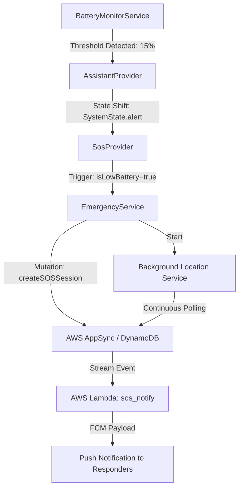

# Technical Specification: Automated Low-Battery Emergency Protocol

## Overview
The **Low-Battery Emergency Protocol** is a critical safety feature of the Suraksha+ ecosystem. It is designed to mitigate the risk of user isolation when a mobile device is approaching complete power exhaustion. By automating the SOS lifecycle, the system ensures that the user's last known coordinates are communicated to emergency contacts before the device becomes unreachable.

## 🏗️ System Architecture

## 📋 Protocol Specifications

### 1. Detection Mechanism
The system utilizes the `BatteryMonitorService` which leverages the `battery_plus` package to interface with the host OS (Android/iOS). 
- **Threshold**: 15% (State of Charge).
- **Sampling Strategy**: Hybrid event-driven (listening to `onBatteryStateChanged`) and periodic polling (5-minute intervals) for redundancy.
- **Hysteresis/Debouncing**: The protocol triggers strictly on a single crossing of the 15% threshold or after a 30-minute cooldown if the battery remains critically low.

### 2. Intelligent SOS Routing
Unlike manual triggers, the Low-Battery flow implements a specialized routing logic to preserve remaining energy and prevent unnecessary emergency dispatch:

- **Emergency Call (112)**: Explicitly **Disabled**. This prevents a "dead-phone" scenario from triggering physical police dispatch when the user is safe but merely uncharged.
- **SMS Transmission**: **Skipped**. Standard SMS dispatch is bypassed in favor of Push Notifications via GCM/FCM to reduce cellular radio utilization.
- **Live Location Tracking**: **Enabled**. High-accuracy GPS is activated to push the terminal location to the cloud.

### 3. AI-Driven Guidance System
Upon protocol activation, the internal **Gemini LLM Assistant** enters a specialized **Guidance Mode**.
- **Contextual Awareness**: The AI is injected with the specific `batteryLevel` and `SystemState.alert` context.
- **Objective**: Provide the user with immediate actionable advice, such as identifying the nearest public charging infrastructure or safe zones.

## 🔬 Research Rationale
This feature addresses the "Blackout Vulnerability" in personal safety apps—where the app becomes useless at the exact moment the phone dies. By preemptively sharing the location and state, Suraksha+ creates a "digital breadcrumb" that persists in the AWS cloud even after hardware shutdown.
